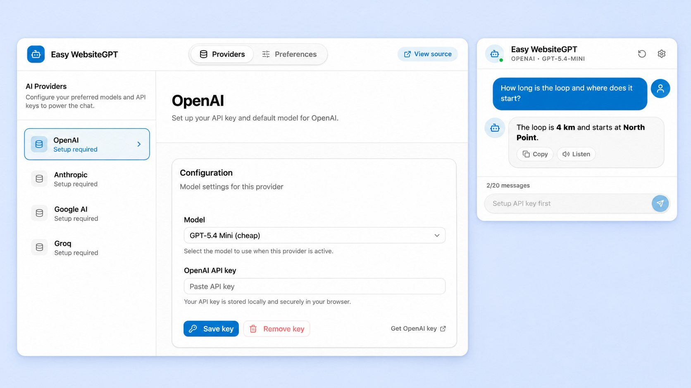

#  Easy WebsiteGPT

Ask questions about the webpage you have open. Easy WebsiteGPT uses the page text as context and keeps a separate chat history for each URL. **You’ll need an API key** from a supported provider.



[](https://wxt.dev/)
[](https://react.dev/)
[](https://ai-sdk.dev/)
[](https://bun.sh/)

## Features

- **Chat about the current page:** Ask for a summary or for details from the page. Replies stream as the provider generates them.
- **Choose a provider and model:** Use OpenAI, Anthropic, Google AI, or Groq. Your selected provider receives the page context when you send a message.
- **Resume a conversation:** Chat history is saved locally by page URL.

The preview shows a demo conversation, not a live provider response.

## Quick Start

With [Bun](https://bun.sh/) installed, run:

```sh
bun install
bun run build
```

In `chrome://extensions`, enable **Developer mode**, click **Load unpacked**, and select `.output/chrome-mv3`. Open the extension’s **Settings**, select a provider, and save its API key. Then open a webpage and ask a question from the popup.

## Development

| Command             | Description                          |
| ------------------- | ------------------------------------ |
| `bun run dev`       | Run the Chrome build with hot reload |
| `bun run typecheck` | Check TypeScript                     |
| `bun run format`    | Format with Prettier                 |
| `bun run zip`       | Build a ZIP for the Chrome Web Store |

See [AGENTS.md](AGENTS.md) for notes on page extraction, providers, and chat history.

## License

[MIT](LICENSE)
